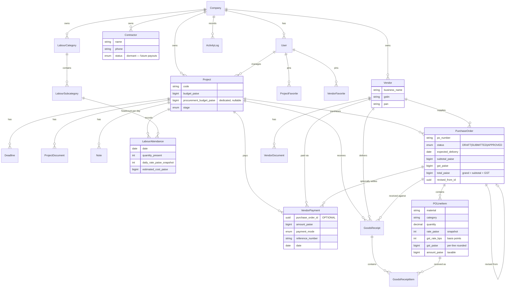

# Entity-Relationship Diagram

_Visual companion to [database.md](./database.md). Regenerate when the schema changes. Money columns are integer paise; every domain table carries `company_id` + timestamps and is protected by RLS._

## Derived (never stored)

These are computed by pure functions from the tables above — no columns, no drift:

- **Budget used / remaining** = Σ labour snapshots + Σ counted PO grand totals (`src/features/budget/calc.ts`).
- **Vendor / project outstanding** = Σ counted PO grand totals − Σ payments (`src/features/procurement/calc.ts`).
- **PO payment status, aging buckets, vendor ledger** — all derived from PurchaseOrder + VendorPayment.

## Notes

- `GoodsReceipt` / `GoodsReceiptItem` are schema + RLS ready; receiving UI is deferred (ADR-0024).
- `Contractor` stays dormant for future payouts (ADR-0021) — no per-worker tracking in the MVP.
- Forward-compat (ADR-0025): CGST/SGST/IGST split, HSN codes, and tax-inclusive pricing attach as derived logic / nullable columns with no redesign.
